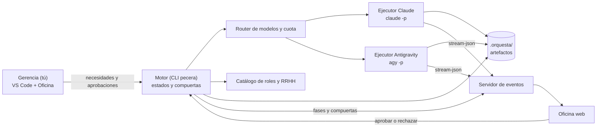
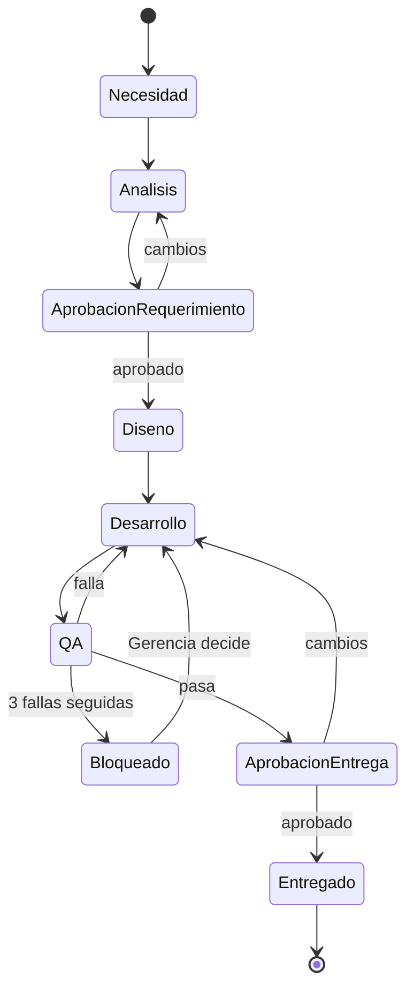
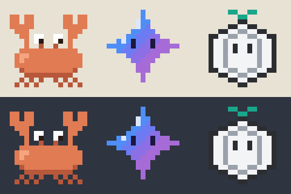

# Orquesta IAs — Documento de diseño

| | |
|---|---|
| Versión | 0.2 (borrador) |
| Fecha | 2026-10-30 |
| Estado | En revisión. Las decisiones tomadas están en la sección 17 |

## 1. Resumen

Orquesta IAs es una "empresa" de agentes de IA que lleva cada proyecto desde la necesidad hasta la entrega, igual que en una empresa real: la necesidad pasa por PMO, Arquitectura, Desarrollo y QA antes de entregarse. El sistema:

- reparte el trabajo entre las suscripciones disponibles (Claude y Gemini Pro);
- arma el equipo según el tipo de proyecto;
- contrata roles nuevos cuando hace falta, con aprobación;
- muestra el trabajo en vivo en una oficina visual.

La idea central es: **el proceso es código; los empleados son IA.** El flujo entre áreas, las compuertas y los documentos de entrega los controla un motor determinista. Los modelos solo hacen el trabajo dentro de cada fase.

## 2. Objetivos y no objetivos

### Objetivos

| ID | Objetivo | Cómo se mide |
|---|---|---|
| O1 | Aprovechar las dos suscripciones | Porcentaje del trabajo (tokens) hecho con Antigravity sin bajar la calidad de entrega |
| O2 | Proceso por fases con compuertas verificables | Trabajos con todos sus artefactos; ciclos de QA a Desarrollo por trabajo |
| O3 | Equipo adaptado a cada proyecto | El equipo cambia según el tipo de proyecto, sin roles que nunca trabajan |
| O4 | Ver el trabajo en tiempo real | Cada acción de un agente aparece en la oficina en menos de 2 s |
| O5 | Control humano | Toda entrega y toda acción sobre infraestructura real pasa por aprobación |

### No objetivos (v1)

- Autonomía total de punta a punta.
- Ejecutar comandos en servidores reales sin aprobación.
- Usar API keys de pago, o reutilizar tokens OAuth fuera de los binarios oficiales.
- Multiusuario o despliegue en la nube.
- Agentes que conversan libremente entre sí.

## 3. Contexto y restricciones

Todo lo de esta sección se verificó en la máquina de desarrollo el 2026-10-30.

### 3.1 Suscripciones y herramientas

| Suscripción | Acceso | Uso desde el motor |
|---|---|---|
| Claude | Extensión de VS Code (Claude Code 2.1.312) | La extensión incluye el binario `claude`. `claude -p` funciona sin interfaz, con la misma sesión y sin API key |
| Gemini Pro (Antigravity) | CLI `agy` 1.4.7 | `agy -p` con salida `json` o `stream-json` |

El binario de Claude está en `~/.vscode/extensions/anthropic.claude-code-<versión>-darwin-arm64/resources/native-binary/claude`. La ruta cambia con cada actualización de la extensión, así que el motor busca la versión más reciente al arrancar. **Decisión:** por ahora se usa este binario. El CLI oficial, que usa la misma suscripción, se instala más adelante.

`claude -p` gasta la misma cuota que la extensión: orquestar no crea cuota nueva de Claude.

### 3.2 Modelos disponibles en `agy`

| Familia | Identificadores |
|---|---|
| Gemini 4 Argon | `gemini-4-argon-low`, `-medium`, `-high` |
| Gemini 3.8 Flash | `gemini-3.8-flash-low`, `-medium`, `-high` |
| Claude Opus 5.5 | `claude-opus-5-5-low`, `-medium`, `-high` |
| Claude Sonnet 5.5 | `claude-sonnet-5-5-low`, `-medium`, `-high` |
| GPT-OSS 120B | `gpt-oss-120b-medium` |

Los modelos Claude y GPT-OSS que corren dentro de Antigravity gastan la cuota de Gemini Pro, no la de la suscripción de Claude.

### 3.3 Cuotas

- **Claude:** los límites son de la cuenta y se comparten entre la extensión y `claude -p`.
- **Antigravity (Google AI Pro):** la página de planes, citada en el foro de Google, promete una cuota que se refresca cada 5 horas, más un límite semanal. Entre enero y febrero de 2026 hubo muchos reportes de usuarios con bloqueos de varios días en los modelos Claude y GPT-OSS dentro de Antigravity. Por eso **Claude vía Antigravity se trata como reserva**, no como plan principal.
- **Cuota restante:** ninguno de los dos CLI la expone (no aparece en `agy --help`). El motor lleva su propia contabilidad con el campo `usage` de cada respuesta y detecta los errores de cuota.

### 3.4 Comportamiento de `agy -p`

| Prueba | Resultado | Consecuencia para el diseño |
|---|---|---|
| Salida redirigida, sin terminal | Funciona, unos 7 s | Se puede llamar desde el motor |
| `--json-schema` | Devuelve `structured_output` ya parseado | Los artefactos estructurados los valida el propio `agy` |
| Contexto por stdin | Lo ignora | El ejecutor mete el contenido en el prompt |
| Leer archivos en `--mode plan` o con `--sandbox` | Bloquea los comandos y responde vacío | Lectura = contenido en el prompt, más `--mode plan` |
| Leer archivos en `--mode auto` | Una vez funcionó; otra vez se denegó `pwd && ls -la` y respondió vacío | No depender de que `agy` explore solo. Una respuesta vacía se trata como fallo |
| Costo base | Unos 10K tokens de entrada y entre 3 y 15 s por llamada | No delegar tareas triviales |
| `stream-json` | Eventos `init`, `step_update` (paso, herramienta, estado `ACTIVE`/`DONE`/`ERROR`, `usage`) y `result` | Alimenta directamente la oficina |

El evento `init` también lista herramientas de navegador, `generate_image` y `define_subagent`. Ninguna se ha probado todavía en modo sin interfaz.

## 4. Principios de diseño

1. **El proceso es código; los empleados son IA.** Una máquina de estados decide qué fase sigue. Ningún modelo puede saltarse una compuerta.
2. **Las áreas se comunican con documentos, no por chat.** Cada fase entrega un artefacto con estructura fija, y la siguiente fase solo recibe ese artefacto. Esto ataca la principal causa de fallas en sistemas multiagente: el desalineamiento entre agentes.
3. **Cada ejecución empieza con contexto limpio.** Cada vez que corre un rol se lanza un proceso nuevo que recibe solo lo que necesita. Así no se arrastra contexto entre fases y el costo de cada rol se puede medir.
4. **QA aprueba con evidencia, y revisa otra familia de modelo.** Un criterio se cumple solo si un comando lo demuestra (tests, `curl`, lint). Quien revisa es de una familia de modelo distinta a la de quien desarrolló.
5. **Cada rol tiene el modelo que le corresponde por costo y capacidad.** Se delega a otro modelo cuando la entrada es grande y la salida pequeña, o cuando el trabajo es mecánico.
6. **Contratar requiere aprobación.** No se crean roles sin tu visto bueno, y los que dejan de usarse se archivan.
7. **Tú eres la Gerencia.** Apruebas el requerimiento y la entrega. Nada toca infraestructura real sin tu aprobación.

## 5. Arquitectura



### 5.1 Componentes

| Componente | Responsabilidad | Tecnología | ¿Usa un modelo? |
|---|---|---|---|
| Motor (CLI `pecera`) | Máquina de estados por trabajo. Valida artefactos, abre y cierra compuertas, llama a los ejecutores y registra eventos | CLI en TypeScript | No |
| Router | Elige modelo y suscripción para cada rol y aplica los respaldos | Módulo del motor | No |
| Ejecutor Claude | Corre un rol con `claude -p`: prompt del rol, permisos acotados, salida `stream-json` | Adaptador | Sí |
| Ejecutor Antigravity | Corre un rol con `agy -p`: contenido en el prompt, `--json-schema` cuando el artefacto es estructurado | Adaptador | Sí |
| Catálogo y RRHH | Definiciones de roles, equipo por tipo de proyecto y propuestas de contratación | Archivos `.md` y el rol `rrhh` | Solo RRHH |
| Servidor de eventos | Recibe y guarda eventos, los emite por WebSocket y recibe las aprobaciones desde la oficina | Node | No |
| Oficina (La Pecera) | Muestra agentes, tablero de trabajos y consumo | Web; la abre `pecera oficina` | No |
| Consola de Gerencia | Crear necesidades, ver el estado y aprobar desde Claude Code en VS Code | Skill `/pecera` que llama al motor | Sí (tu sesión) |

### 5.2 Modos de operación

- **Interactivo (v1):** desde VS Code le pides a Claude Code `/pecera nueva "..."`. El motor corre las fases en segundo plano y se detiene en cada compuerta humana. Todo se ve en la oficina.
- **Desatendido (más adelante):** `pecera procesar` procesa una cola, por ejemplo de noche, y deja los trabajos esperando en las compuertas humanas.

## 6. Ciclo de vida de un trabajo



| Fase | Área | Entrada | Artefacto de salida | Compuerta | Ejecutor por defecto |
|---|---|---|---|---|---|
| Necesidad | Gerencia | Tu descripción | `necesidad.md` | — | Tú |
| Análisis | PMO | `necesidad.md` y perfil del proyecto | `requerimiento.md` | Humana: apruebas el requerimiento | Gemini 4 Argon high |
| Diseño | Arquitectura | `requerimiento.md` y código relevante | `plan.md` y `tareas.json` | Automática: `tareas.json` cumple el esquema. Humana si el plan toca la base de datos o más de N archivos | Claude Opus |
| Desarrollo | Desarrollo | Una tarea de `tareas.json` | Cambios en un worktree y resumen | Automática: compila y los tests pasan | Claude. Las tareas mecánicas, Gemini Flash |
| QA | QA | `requerimiento.md` y el diff | `qa-report.json` | Automática: cada criterio de aceptación tiene evidencia | Gemini Flash ejecuta; revisa otra familia de modelo |
| Entrega | Gerencia | Todo lo anterior | `entrega.md` (commit, PR y pasos de prueba) | Humana: apruebas el merge | Reutiliza la skill `entrega-tarea` |

**Carriles.** Al crear un trabajo eliges el carril; PMO puede sugerir otro.

- **Completo:** todas las fases.
- **Rápido** (bugs pequeños y cambios acotados): Necesidad → Desarrollo → QA → Entrega.

## 7. Contratos de artefactos

```
<proyecto>/
└── .orquesta/
    ├── proyecto.yaml          # perfil: tipo, stack y equipo asignado
    ├── equipo/                # roles contratados para este proyecto
    ├── trabajos/
    │   └── T-0001-login-con-google/
    │       ├── estado.json
    │       ├── necesidad.md
    │       ├── requerimiento.md
    │       ├── plan.md
    │       ├── tareas.json
    │       ├── qa-report.json
    │       └── entrega.md
    └── eventos.jsonl
```

`.orquesta/` se agrega al `.gitignore` del proyecto por defecto, porque los eventos guardan salidas de comandos. Tú decides qué artefactos se publican.

### `proyecto.yaml`

Ejemplo para `cooperativa-app`:

```yaml
nombre: cooperativa-app
tipos: [servicio, frontend]
aislamiento: rama          # rama | worktree (ver sección 10)
excluir:                   # nunca se envían a un modelo
  - .env
  - .agent/reportes/       # bitácora y borradores de advisories privados
  - backend/uploads/       # documentos de personas
reglas:                    # el ejecutor las incluye en el prompt de cada rol
  - .agent/rules/PROJECT_RULES.md
equipo: [pmo-analista, arquitecto, dev-backend, dev-frontend, db-reviewer, seguridad, qa-api, ux-reviewer]
comandos_qa: []            # se llena al registrar el proyecto
```

### `requerimiento.md`

Secciones fijas:

- **Objetivo.**
- **Alcance:** qué incluye y qué no.
- **Criterios de aceptación:** `CA-1`, `CA-2`… Cada uno indica cómo se verifica.
- **Riesgos.**
- **Preguntas abiertas.** Si hay alguna sin responder, la compuerta no pasa. Así se evita que un agente avance con supuestos en vez de preguntar.

### `tareas.json`

```json
{
  "trabajo": "T-0001",
  "tareas": [
    {
      "id": "TA-1",
      "titulo": "Agregar endpoint POST /auth/google",
      "rol": "dev-backend",
      "tipo": "complejo",
      "archivos": ["src/auth/google.ts", "src/routes.ts"],
      "criterios": ["CA-1", "CA-2"],
      "depende_de": []
    }
  ]
}
```

El campo `tipo` (`mecanico` o `complejo`) es lo que el router usa para elegir el modelo.

### `qa-report.json`

```json
{
  "trabajo": "T-0001",
  "veredicto": "falla",
  "criterios": [
    {
      "id": "CA-1",
      "estado": "cumple",
      "evidencia": { "comando": "npm test -- auth", "salida": "12 passed", "codigo_salida": 0 }
    },
    {
      "id": "CA-2",
      "estado": "no_cumple",
      "evidencia": { "comando": "curl -i -X POST localhost:3000/auth/google", "salida": "HTTP/1.1 500", "codigo_salida": 0 },
      "hallazgo": "No valida un token vacío"
    }
  ],
  "revisor": { "rol": "qa", "modelo": "gemini-3.8-flash-medium" }
}
```

### `estado.json`

```json
{
  "trabajo": "T-0001",
  "carril": "completo",
  "fase": "qa",
  "ciclos_qa": 1,
  "historial": [
    {
      "fase": "analisis",
      "rol": "pmo-analista",
      "modelo": "gemini-4-argon-high",
      "suscripcion": "antigravity",
      "inicio": "2026-10-30T14:00:00Z",
      "fin": "2026-10-30T14:01:10Z",
      "tokens": { "entrada": 31200, "salida": 1850 }
    }
  ]
}
```

Los esquemas se definen una sola vez con Zod. De ahí se exporta el JSON Schema que recibe `agy --json-schema`.

## 8. Roles, catálogo y contratación

### 8.1 Definición de un rol

Un rol es un archivo Markdown con frontmatter, en el mismo formato que `.agent/agents/` y `.claude/agents/`, para aprovechar la sincronización que ya existe (`sync-agents.mjs`). Los campos propios de Orquesta se agregan sin romper ese formato:

```markdown
---
nombre: qa-api
area: qa
descripcion: Verifica servicios HTTP contra los criterios de aceptación, con evidencia ejecutable.
tipos_de_proyecto: [servicio]
modelos:                       # en orden de preferencia: <modelo>@<suscripción>
  - gemini-3.8-flash-medium@antigravity
  - sonnet@claude
permisos: lectura-y-comandos   # lectura | lectura-y-comandos | escritura
entradas: [requerimiento.md, diff]
salida: qa-report.json
personaje:
  accesorio: lupa
---
Eres QA de servicios HTTP. ...
```

La notación `<modelo>@<suscripción>` deja claro quién paga cada ejecución.

### 8.2 Catálogo base (v1)

| Rol | Área | Modelo preferido | Respaldo |
|---|---|---|---|
| `pmo-analista` | PMO | `gemini-4-argon-high@antigravity` | `opus@claude` |
| `arquitecto` | Arquitectura | `opus@claude` | `gemini-4-argon-high@antigravity` |
| `dev-backend` / `dev-frontend` | Desarrollo | `sonnet@claude` u `opus@claude` | `claude-sonnet-5-5-high@antigravity` |
| `dev-mecanico` | Desarrollo | `gemini-3.8-flash-medium@antigravity` | `haiku@claude` |
| `qa` (y sus variantes) | QA | `gemini-3.8-flash-medium@antigravity` | `sonnet@claude` |
| `revisor-codigo` | QA | Familia distinta a la de quien desarrolló | — |
| `seguridad` | Seguridad | `gemini-4-argon-high@antigravity` | `opus@claude` |
| `sysadmin` | Infraestructura | `opus@claude` | `gemini-4-argon-high@antigravity` |
| `documentador` | Documentación | `gemini-3.8-flash-low@antigravity` | — |
| `rrhh` | RRHH | `gemini-4-argon-medium@antigravity` | — |

Los agentes que ya existen (`code-reviewer`, `db-reviewer`, `security-auditor`, `software-architect` y `ux-reviewer`) entran al catálogo como punto de partida de `revisor-codigo`, `db-reviewer`, `seguridad`, `arquitecto` y `ux-reviewer`.

### 8.3 Equipo según el tipo de proyecto

| Tipo | Cómo se detecta | Equipo |
|---|---|---|
| Servicio / API | Framework web en el manifiesto, Dockerfile, rutas HTTP | `pmo-analista`, `arquitecto`, `dev-backend`, `db-reviewer` (si hay base de datos), `seguridad`, `qa-api`, `documentador` |
| Infraestructura | Scripts de shell, Ansible, cloud-init, nginx o systemd, sin aplicación | `pmo-analista`, `sysadmin`, `seguridad` (hardening), `qa-infra`, `documentador` (runbook) |
| Frontend / web | Framework de interfaz | `pmo-analista`, `arquitecto`, `dev-frontend`, `ux-reviewer`, `qa-e2e`, `documentador` |

Si un proyecto mezcla tipos, se combinan los equipos.

### 8.4 Contratación (RRHH)

1. **Disparadores:**
   - se registra un proyecto nuevo y hay que asignarle equipo;
   - una fase necesita una capacidad que ningún rol cubre;
   - QA reporta el mismo tipo de hallazgo dos veces o más.
2. **Propuesta:** RRHH escribe `propuesta-contratacion.md` con el rol, el motivo y su evidencia, el alcance, el modelo, los permisos y si el rol sirve para otros proyectos.
3. **Compuerta humana:** apruebas, ajustas o rechazas.
4. **Alta:** si el rol es reutilizable va al catálogo de este repo; si no, a `.orquesta/equipo/` del proyecto.
5. **Baja:** un rol que no trabaja en N trabajos seguidos se propone para archivar.

La skill `preparar-proyecto` se convierte en la primera versión del proceso de incorporación de RRHH.

## 9. Enrutamiento y cuotas

El router aplica estas reglas en orden:

1. Lista de preferencia del rol.
2. Tipo de tarea: `mecanico` o `complejo`.
3. Diversidad: quien revisa en QA es de una familia de modelo distinta a la de quien desarrolló.
4. Disponibilidad: si una suscripción está "fuera de turno" (tuvo un error de cuota reciente), pasa a la siguiente opción.
5. Costo mínimo: no se delega a `agy` una tarea trivial, por su costo base de unos 10K tokens.

**Detección de cuota.** En la Fase 0 hay que capturar los mensajes reales de error de cuota de cada CLI. Con eso se marca una suscripción como fuera de turno y se estima cuándo vuelve.

**Contabilidad.** Cada ejecución registra los tokens de entrada y salida, la duración, el modelo y la suscripción.

## 10. Seguridad y permisos

| Nivel | Ejemplos | Cómo se ejecuta |
|---|---|---|
| Lectura | Analizar, revisar, resumir | Contenido en el prompt. `agy --mode plan`; `claude` sin herramientas de escritura |
| Lectura y comandos | QA corre tests o hace `curl` local | Lista de comandos permitidos. `claude --allowedTools`; en `agy`, se resuelve en la Fase 0 |
| Escritura | Desarrollo | Nunca en la rama principal. Un git worktree por tarea si el proyecto lo permite; si no, la rama que crea Gerencia (ver `aislamiento`). El motor revisa el diff y la compuerta decide |
| Infraestructura real | Aplicar cambios a tu servidor Ubuntu | Los agentes generan scripts o playbooks y los prueban en una VM o contenedor. En el servidor real se ejecutan solo con tu aprobación explícita, y los ejecuta el motor, no el agente |

Reglas:

- `agy --dangerously-skip-permissions` solo dentro de un contenedor desechable, nunca directamente en tu máquina.
- No se pasan secretos en los prompts. Lo que aparece en `excluir` de `proyecto.yaml` (secretos, reportes privados de seguridad, documentos de personas) nunca se incluye en el contenido que se manda a un modelo, y `.orquesta/` no guarda secretos.
- **Aislamiento.** Solo se usan worktrees si el proyecto puede levantar una copia aislada. Si su Docker Compose fija los nombres del volumen o de la red, como `cooperativa-app`, dos copias comparten la misma base de datos y pueden corromperla. En ese caso `aislamiento: rama`: una sola copia, un solo stack y la rama que crea Gerencia.
- La entrega respeta las reglas de cada proyecto: quién hace el commit y el PR, el formato de los mensajes y si llevan atribución.
- Solo se usan los binarios oficiales. No se extraen ni se reutilizan tokens OAuth.

## 11. Observabilidad y oficina

### 11.1 Modelo de eventos

```json
{
  "ts": "2026-10-30T14:03:22.120Z",
  "trabajo": "T-0001",
  "fase": "qa",
  "agente": "qa-api#1",
  "rol": "qa-api",
  "modelo": "gemini-3.8-flash-medium",
  "suscripcion": "antigravity",
  "tipo": "herramienta",
  "detalle": "npm test -- auth",
  "tokens": { "entrada": 0, "salida": 0 }
}
```

Tipos de evento: `fase_iniciada`, `agente_inicio`, `herramienta`, `mensaje`, `agente_fin`, `error`, `esperando_aprobacion`, `aprobado`, `rechazado`, `fuera_de_turno` y `contratacion`.

### 11.2 Fuentes de eventos

| Fuente | Cómo se obtienen |
|---|---|
| Motor | Emite directamente los cambios de fase y las compuertas |
| Ejecutor Antigravity | Traduce el `stream-json` de `agy`: `init` → `agente_inicio`; `step_update` de herramienta en `ACTIVE` → `herramienta`; `ERROR` → `error`; `result` → `agente_fin` con el consumo |
| Ejecutor Claude | Traduce `claude -p --output-format stream-json`. El formato exacto se confirma en la Fase 0 |
| Tu sesión en VS Code | Opcional: hooks de Claude Code (`PreToolUse`, `PostToolUse`, `SubagentStop`…) para que tú también aparezcas en la oficina |

### 11.3 La oficina: La Pecera

En muchas oficinas, la pecera es la sala de vidrio donde todos te ven trabajar. Aquí es donde miras a tus agentes. Se abre con `pecera oficina`.

**Salas:** Gerencia (tu oficina, con la bandeja de aprobaciones), PMO, Arquitectura, Desarrollo, QA, Infraestructura, Seguridad, RRHH y una sala de descanso para los agentes fuera de turno.

**Paneles:**

- tablero Kanban de los trabajos por fase;
- medidores de consumo de cada suscripción;
- línea de tiempo del trabajo seleccionado;
- botones de aprobar o rechazar en cada compuerta.

### 11.4 Personajes

Cada personaje combina tres capas:

- **el personaje** indica quién piensa: la familia del modelo;
- **el accesorio** indica qué hace: el rol;
- **el gafete** indica quién paga y con qué modelo exacto: la suscripción y el identificador.



| Familia | Personaje | Diseño | Variantes | Estado |
|---|---|---|---|---|
| Claude | **Pinzas** | Cangrejo naranja con pinzas levantadas y ojos sobre antenas. Inspirado en la mascota de Claude Code, con diseño propio | Opus grande, Sonnet mediano, Haiku pequeño | Aprobado |
| Gemini | **Chispa** | Destello de cuatro puntas con degradado de azul a violeta. Inspirado en el ícono de Gemini, que no tiene mascota oficial. Flota en vez de caminar | Argon con brillo intenso; Flash con estela de velocidad | Aprobado |
| GPT-OSS | **Nudo** | Hexágono blanco con un anillo gris concéntrico que enmarca la cara (un nudo o una tuerca vista de frente) y un brote verde azulado en la cabeza, por "pesos abiertos". Avanza a saltitos | — | Aprobado |
| Tú | Gerencia | Por diseñar | — | — |

Los sprites viven en [`personajes/sprites.json`](personajes/sprites.json), en el formato de `textures.generate` de Phaser: cada fila es un texto, cada carácter es una clave de la paleta y `.` es transparente. La hoja se regenera con `node scripts/render-sprites.mjs`.

- El nivel (low, medium, high) se ve como la intensidad de un aura alrededor del personaje.
- Claude vía Antigravity es el mismo cangrejo con gafete de Antigravity, para que se note cuándo Claude está gastando la cuota de Gemini.
- Accesorios por rol: PMO lleva portapapeles; arquitecto, planos; desarrollo, laptop; QA, lupa; seguridad, escudo; sysadmin, llave inglesa; documentador, libro; RRHH, carpeta de CV.

| Estado | Animación | Evento que lo activa |
|---|---|---|
| Inactivo | Sentado en su escritorio | — |
| Caminando | Va a la sala de la fase | `fase_iniciada` |
| Leyendo | Hojea papeles | Herramienta de lectura |
| Escribiendo | Teclea | Edición de archivos |
| Ejecutando | Pantalla con terminal | Comando |
| Esperando aprobación | Globo con "?" en la puerta de Gerencia | `esperando_aprobacion` |
| Error | Globo con "!" | `error` |
| Celebrando | Salta | Compuerta aprobada |
| Fuera de turno | Duerme en la sala de descanso, con un reloj de regreso | `fuera_de_turno` |

**Marcas.** El repo es público. Los sprites son originales e inspirados en cada marca; no se copian logos ni arte oficial. El README lleva este aviso:

> Orquesta IAs es un proyecto personal sin afiliación con Anthropic, Google ni OpenAI. Claude, Gemini, Antigravity y GPT-OSS son marcas de sus respectivos dueños.

**Producción.** Los sprites base son de 16×16 px y se dibujan como texto en `sprites.json`. Las animaciones (caminar, teclear, celebrar) se agregan como cuadros adicionales del mismo personaje.

## 12. Stack tecnológico

| Parte | Elección | Motivo |
|---|---|---|
| Lenguaje | TypeScript sobre Node (v26 instalado) | Una sola base para motor, servidor y oficina; `sync-agents.mjs` ya es Node |
| Validación | Zod, exportando JSON Schema | El mismo esquema sirve para TypeScript y para `agy --json-schema` |
| Eventos | JSONL al principio; SQLite cuando haga falta consultar | Lo simple primero |
| Tiempo real | WebSocket | — |
| Oficina | Vite y Phaser 3 (decidido), con el mapa hecho en Tiled | Trae tilemaps, sprites y animaciones listos, y genera texturas desde los sprites en texto |
| Repositorio | Monorepo con workspaces de npm | npm ya está instalado |

## 13. Estructura del repositorio

```
orquesta-ias/
├── docs/
│   ├── diseno.md
│   └── personajes/     # sprites.json y hoja.png
├── catalogo/roles/*.md # catálogo global; `pecera instalar` lo enlaza donde lo leen Claude Code y Antigravity
├── scripts/            # render-sprites.mjs y utilidades
├── packages/
│   ├── contratos/      # esquemas Zod de artefactos y eventos
│   ├── motor/          # CLI pecera: estados, compuertas, router
│   ├── ejecutores/     # adaptadores de claude y agy
│   └── servidor/       # eventos, WebSocket y aprobaciones
├── apps/pecera/        # oficina en Phaser
└── skills/pecera/      # skill /pecera para Claude Code
```

## 14. Hoja de ruta

| Fase | Alcance | Criterio de salida |
|---|---|---|
| 0. Prueba de concepto | Ejecutores de `claude` y `agy`; contratos de `requerimiento`, `tareas` y `qa-report`; un flujo fijo (Análisis → aprobación → Desarrollo → QA) sobre `cooperativa-app` con la tarea H-62 (sección 14.1); eventos en JSONL; permisos de `agy` resueltos para QA | Orquesta logra la misma calidad que Claude Code solo en tareas parecidas y gasta menos cuota de Claude. Si no, se ajusta antes de seguir |
| 1. Empresa | Catálogo, perfiles de proyecto, RRHH, carril rápido, worktrees y skill `/pecera` | `cooperativa-app` (servicio) e `infraestructura-stevenserver` (infraestructura) reciben equipos distintos sin configurarlos a mano |
| 2. Oficina | Servidor de eventos; oficina con salas, personajes, tablero y aprobaciones | Se ve en vivo un trabajo completo y se aprueba desde la oficina |
| 3. Optimización | Router que conoce la cuota, estado fuera de turno, modo desatendido y más áreas | Una semana de uso sin chocar con los límites y sin cambiar de modelo a mano |

### 14.1 Proyecto piloto (Fase 0)

**Proyecto:** [`cooperativa-app`](https://github.com/StevOxd/cooperativa-app), el proyecto de graduación. Tiene backend y banco simulado en Node, frontend con Vite, PostgreSQL en Docker Compose, y producción en el servidor Ubuntu con despliegue automático después del CI de `main`, que requiere aprobación en el entorno `production`.

**Por qué este proyecto:**

- Tiene necesidades reales en su backlog, no un ejemplo de juguete.
- Ya tiene sus agentes en formato Antigravity (`.agent/agents/`) sincronizados con Claude Code. El equipo ya existe.
- Tiene unas 25 pruebas de integración (`backend/test*.js`) que corren contra el stack de Docker y sirven como evidencia para QA. El CI solo corre lint, build y revisión de sintaxis, así que QA necesita Docker Desktop encendido en la Mac.
- Su flujo ya tiene compuertas humanas: tú creas la rama, haces el commit y el PR, y apruebas el despliegue.
- Tiene su pareja de infraestructura (el servidor Ubuntu) para probar el perfil de infraestructura en la Fase 1.
- El código ya es público, así que enviarlo a los modelos no expone código nuevo.

**Tarea piloto: H-62.** nginx corta con un 413 los PDF de crédito de más de unos 750 KB, porque `location /api/` no define `client_max_body_size` (rige el límite de 1 MB) mientras Express acepta 15 MB. La propuesta de la bitácora es un `location` con 8 MB para las tres rutas que suben el PDF firmado, y un mensaje claro en el frontend ante un 413. Ya está publicada como issue [#78](https://github.com/StevOxd/cooperativa-app/issues/78).

Por qué esta tarea:

- Es acotada: una configuración de nginx y un mensaje en el frontend.
- Sus criterios se pueden verificar con `curl`: un PDF de 1 MB o de 7 MB no da 413; uno de 9 MB da 413 y el frontend muestra el mensaje.
- Pasa por servicio, infraestructura ligera (nginx) y seguridad (límites de tamaño), así que participan varios roles.
- No toca dinero ni la base de datos.
- Puede mostrarse en el caso de estudio del portafolio.

**Condiciones:**

1. Orquesta nunca toca `main` ni el servidor. Trabaja en la rama que tú creas; tú haces el commit y el PR, y el despliegue mantiene su aprobación en GitHub.
2. `aislamiento: rama`: una sola copia y un solo stack de Docker, sin worktrees, por los nombres fijos del volumen y la red.
3. Se excluyen `.env`, `.agent/reportes/` y `backend/uploads/`.
4. La entrega sigue las reglas del proyecto.
5. **Medición sin repetir trabajo.** La línea base sale del consumo de Claude Code en tareas parecidas ya hechas en este proyecto (los transcripts de `~/.claude/projects/` guardan el `usage` de cada mensaje).
6. No compite con la graduación: H-62 ya está en el backlog, y si el resultado sirve se entrega como cualquier otra tarea.

## 15. Métricas

- Consumo de cada suscripción por trabajo (tokens y llamadas).
- Proporción del trabajo hecho con Antigravity.
- Ciclos de QA a Desarrollo por trabajo.
- Intervenciones de Gerencia por trabajo, además de las compuertas.
- Tiempo total por trabajo y por fase.
- Fallas que QA no detectó y aparecieron después.

## 16. Riesgos

| Riesgo | Impacto | Mitigación |
|---|---|---|
| Se pierde información entre áreas | Alto | Artefactos con estructura fija; las preguntas abiertas bloquean la compuerta |
| Orquestar gasta más cuota que trabajar solo con Claude | Alto | Medirlo en la Fase 0; carril rápido; no delegar lo trivial |
| `agy` cambia o falla en modo sin interfaz | Medio | Adaptador aislado, prueba de humo al arrancar y respaldo a Claude |
| `agy` responde vacío por permisos | Medio | Contenido en el prompt; una respuesta vacía se reintenta o se reporta como fallo |
| Cambia la ruta del binario de Claude | Bajo | Buscar la versión más reciente en cada arranque |
| Bloqueos de varios días en Claude vía Antigravity | Medio | Tratarlo solo como reserva |
| Agentes con acceso a infraestructura real | Alto | Sin ejecución directa: aprobación humana y ejecución por el motor |
| Dos stacks de Docker comparten la base de datos (nombres fijos de volumen o red) | Alto | Campo `aislamiento` por proyecto; en esos proyectos no se usan worktrees |
| Se filtra información privada al repo público o a un modelo | Alto | Lista `excluir` por proyecto; `.orquesta/` en `.gitignore`; el caso de estudio solo usa issues públicos |
| Demasiados roles | Bajo | Contratación con aprobación y bajas por desuso |
| El alcance del proyecto crece demasiado | Alto | Fases con criterio de salida; la oficina llega después de probar que el proceso aporta |

## 17. Decisiones

### Tomadas

| # | Pregunta | Decisión | Fecha |
|---|---|---|---|
| 1 | ¿Dónde vive el catálogo global? | En este repo (`catalogo/`); `pecera instalar` lo enlaza donde lo leen Claude Code y Antigravity | 2026-10-30 |
| 2 | ¿Qué motor usa la oficina? | Phaser 3 | 2026-10-30 |
| 3 | ¿El repo es público? | Sí, con aviso de marcas (sección 11.4) | 2026-10-30 |
| 4 | ¿Qué personaje lleva cada familia? | Pinzas (Claude), Chispa (Gemini) y Nudo (GPT-OSS), sección 11.4 | 2026-10-30 |
| 5 | ¿Con qué proyecto se hace la Fase 0? | `cooperativa-app`, tarea H-62, issue #78 (sección 14.1) | 2026-10-30 |
| 6 | ¿CLI oficial de Claude o binario de la extensión? | Binario de la extensión por ahora; el CLI se instala más adelante | 2026-10-30 |
| 7 | ¿Licencia? | MIT (`LICENSE`) | 2026-10-30 |
| 8 | ¿Nombres? | Proyecto y repo: Orquesta IAs (`orquesta-ias`), con los datos de cada proyecto en `.orquesta/`. CLI, skill y oficina: La Pecera (`pecera`, `/pecera`) | 2026-10-30 |

### Abiertas

Ninguna por ahora.

## 18. Referencias

- [Why Do Multi-Agent LLM Systems Fail? (MAST)](https://arxiv.org/html/2503.13657v3)
- [How Anthropic Built a Multi-Agent Research System](https://blog.bytebytego.com/p/how-anthropic-built-a-multi-agent)
- [MetaGPT](https://cdn.jsdelivr.net/gh/FoundationAgents/MetaGPT@main/README.md)
- [Pixel Agents](https://github.com/pablodelucca/pixel-agents)
- [Claude Code Hooks Multi-Agent Observability](https://docsearch.algolia.com/mcp/docs/repo/disler/claude-code-hooks-multi-agent-observability)
- [Antigravity CLI: issue #318 (cuelgue sin terminal)](https://github.com/google-antigravity/antigravity-cli/issues/318)
- [Foro de Google AI: cuotas de Antigravity en Google AI Pro](https://discuss.ai.google.dev/t/google-ai-pro-subscription-antigravity-quota-not-working-as-advertised-10-day-lockout-instead-of-5-hour-reset/118505)
- [Foro de Google AI: bloqueos de 7 días en modelos Claude](https://discuss.ai.google.dev/t/google-ai-pro-user-claude-models-stuck-on-7-day-cooldown-should-be-5-hours-happens-on-two-pro-accounts/123419)
